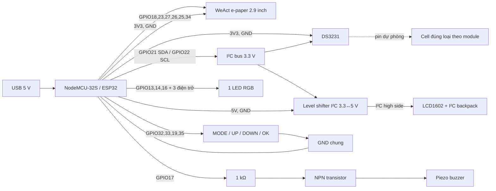

# Desk Buddy — sơ đồ nối dây prototype

Tài liệu này mô tả **mạch phần cứng thật** cho NodeMCU-32S (ESP32-WROOM-32), e-paper WeAct 2.9 inch, LCD1602 I²C, DS3231, một LED RGB, một buzzer và bốn nút. Sơ đồ giả định LED RGB common-cathode và LCD backpack chạy 5 V. Kiểm tra nhãn chân trên đúng module trước khi cấp điện.

## Sơ đồ khối nối dây



## Bảng nối chân

| Thiết bị / chân | Kết nối | Lưu ý |
|---|---|---|
| E-paper VCC, GND | 3V3, GND | Dùng đúng điện áp ghi trên module; sơ đồ này giả định module SPI 3.3 V. |
| E-paper CLK, DIN/MOSI | GPIO18, GPIO23 | SPI clock và dữ liệu từ ESP32. |
| E-paper CS, DC, RST, BUSY | GPIO27, GPIO26, GPIO25, GPIO34 | GPIO34 chỉ input, phù hợp với BUSY; không có pull-up nội. |
| DS3231 VCC, GND | 3V3, GND | Không nối VCC RTC sang 5 V trong cấu hình này. |
| DS3231 SDA, SCL | GPIO21, GPIO22 | Cùng bus I²C 3.3 V với phía thấp của level shifter. |
| Level shifter LV/VCCA, GND | 3V3, GND | LV channel 1/2 lần lượt nhận SDA/SCL từ GPIO21/22. |
| Level shifter HV/VCCB, GND | 5V, GND | HV channel 1/2 lần lượt nối SDA/SCL của LCD. GND phải chung. |
| LCD backpack VCC, GND | 5V, GND | Chân SDA/SCL chỉ đi về phía 5 V của level shifter. Quét địa chỉ I²C thực tế (thường 0x27 hoặc 0x3F). |
| MODE, UP, DOWN | GPIO32, GPIO33, GPIO19; nút còn lại xuống GND | Dùng `INPUT_PULLUP` nội. |
| OK | GPIO35 và nút xuống GND | GPIO35 không có pull-up nội: thêm điện trở 10 kΩ từ GPIO35 lên 3V3. |
| RGB R/G/B | GPIO13/14/16 qua từng điện trở 220–330 Ω vào từng màu | Common cathode nối GND. Một LED RGB, ba điện trở. Xác nhận pinout và cực tính LED. |
| Buzzer piezo chủ động (active) | GPIO17 → điện trở base 1 kΩ → base NPN; emitter → GND; collector → cực âm buzzer; cực dương buzzer → nguồn đúng định mức | Hợp với firmware hiện tại đang bật/tắt GPIO. Không kéo buzzer từ GPIO trực tiếp. Nếu dùng piezo thụ động, firmware cần phát PWM/tone; nếu dùng buzzer điện từ, thêm diode flyback song song (cathode về nguồn dương). |
| NPN | Emitter GND, collector tải buzzer, base qua 1 kΩ từ GPIO17 | Có thể dùng transistor NPN nhỏ phù hợp tải; kiểm tra dòng và điện áp buzzer. |
| GND | ESP32, RTC, e-paper, LCD/level-shifter, LED cathode, emitter NPN cùng GND | Không để các mạch dùng nguồn riêng thiếu mass chung. |

## Danh sách linh kiện cho cấu hình này

| Số lượng | Linh kiện |
|---:|---|
| 1 | NodeMCU-32S / ESP32-WROOM-32 |
| 1 | WeAct e-paper 2.9 inch SPI (xác nhận revision trước khi chọn driver) |
| 1 | LCD1602 kèm backpack I²C |
| 1 | Module RTC DS3231 kèm cell dự phòng tương thích |
| 1 | Level shifter I²C hai kênh, bidirectional 3.3 V ↔ 5 V |
| 4 | Nút nhấn momentary: MODE, UP, DOWN, OK |
| 1 | LED RGB common-cathode |
| 3 | Điện trở 220–330 Ω cho ba màu LED |
| 1 | Điện trở 10 kΩ kéo GPIO35 lên 3V3 |
| 1 | Buzzer piezo chủ động đúng điện áp định mức (nếu dùng loại thụ động thì cần sửa firmware sang PWM/tone) |
| 1 | Transistor NPN phù hợp với buzzer |
| 1 | Điện trở 1 kΩ nối GPIO17 tới base transistor |
| 1 | Diode flyback nếu dùng buzzer điện từ thay piezo |
| 1 | Nguồn USB 5 V ổn định, khuyến nghị 2 A, cùng dây nối |

## Nguồn và kiểm tra trước khi cấp điện

1. Cấp NodeMCU qua USB 5 V ổn định; chân 5V/VIN trên board cấp LCD backpack và HV của level shifter. Không cấp 5 V vào GPIO.
2. Lấy 3V3 từ board cho e-paper, DS3231 và LV của level shifter; không vượt khả năng dòng của bộ ổn áp trên board.
3. DS3231 dùng cell dự phòng theo đúng thiết kế module. Một số board có mạch sạc: không gắn CR2032 không sạc được khi mạch vẫn cấp dòng sạc.
4. Đo/soát lại không có chập 5 V sang SDA/SCL phía ESP32 hoặc các GPIO trước khi cắm USB.
5. Kiểm tra đúng loại panel e-paper và driver theo nhãn mặt sau; phiên bản panel vật lý hiện chưa xác nhận.

## Pin map nhanh

```text
ESP32 GPIO18  -> EPD CLK       ESP32 GPIO23 -> EPD DIN/MOSI
ESP32 GPIO27  -> EPD CS        ESP32 GPIO26 -> EPD DC
ESP32 GPIO25  -> EPD RST       ESP32 GPIO34 -> EPD BUSY
ESP32 GPIO21  -> SDA (RTC + LV side level shifter)
ESP32 GPIO22  -> SCL (RTC + LV side level shifter)
ESP32 GPIO32  -> MODE          ESP32 GPIO33 -> UP
ESP32 GPIO19  -> DOWN          ESP32 GPIO35 -> OK + 10 kΩ pull-up to 3V3
ESP32 GPIO13  -> RGB red       ESP32 GPIO14 -> RGB green
ESP32 GPIO16  -> RGB blue      ESP32 GPIO17 -> buzzer transistor driver
```

## Khác biệt với Wokwi

`simulation/wokwi/diagram.json` là mạch mô phỏng luồng giao diện. Sketch hiện dùng DS1307 giả lập thay DS3231 thật, nối LCD I²C trực tiếp, và không mô phỏng đầy đủ điện trở LED, driver transistor hay pull-up ngoài GPIO35. Vì vậy Wokwi có thể kiểm tra luồng nút/UI, nhưng **không phải sơ đồ đấu phần cứng để lắp thật**. Dùng bảng và sơ đồ trong tài liệu này để đi dây phần cứng.
